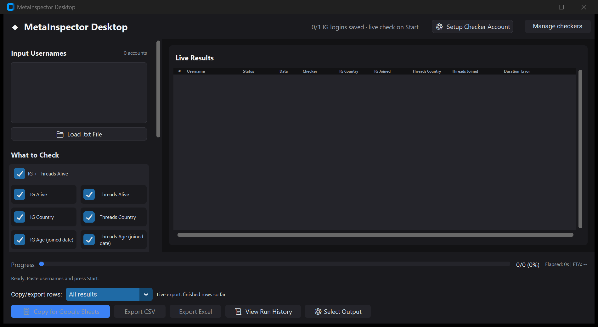
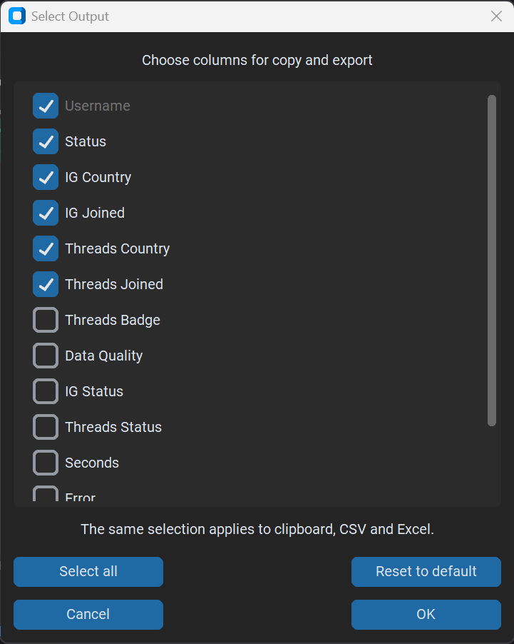

# MetaInspector Desktop Quick Start

Windows 10/11, 64-bit. Use the supplied `MetaInspectorDesktop.exe`.
No Python or Playwright installation is required by this bundled build.
Local verification and its limits are recorded in
[the packaged-build report](implementation/bl01-packaged-verification.md).

## 1. First launch

1. Put the executable in a folder you can access and double-click it.
   First launch may take time while bundled files extract. Maximize or resize
   the window to keep its bottom action buttons above the Windows taskbar.
2. If Windows SmartScreen blocks this unsigned file, verify that it came from
   your trusted delivery first. On the warning, choose **More info**, then
   **Run anyway** if offered. Do not disable Windows security. If an organization
   policy prevents running it, ask the administrator or delivery contact.
3. The header reports saved checker state. A new installation has no saved
   login. This indicator does not prove a live IG and Threads session; the app
   verifies sessions when a logged-in check starts.
4. Results, preferences and sessions live under `%LOCALAPPDATA%\MetaInspector`,
   outside the executable. Keep this folder private; it contains browser logins.

## 2. Checker setup

Skip this section for **IG Status Only (no login, fastest)**.

1. With one checker selected, **Setup Checker Account** opens its setup browser
   directly. To choose accounts first, click **Manage checkers**.
2. In the **Checker accounts** window, select the intended slots and click
   **Login IG + Threads** beside the chosen checker. Chromium opens Instagram.
3. Complete login and any verification. When the normal feed is visible,
   close that browser window. A separate Threads window opens next.
4. Finish Threads login and any onboarding, including the chosen privacy
   setting. Close the window only after the normal feed/profile opens.
5. The app verifies both sessions and reports the outcome. A saved cookie or
   an onboarding screen alone is not a completed setup.
6. **Save selection** stores which checker slots may be used. One healthy
   checker can supply several parallel worker pages; workers are not accounts.

Optional **Import accounts & auto-login** accepts a local UTF-8 text file with
one `username|password|2FA secret` entry per line, up to five entries. The 2FA
value is the permanent authenticator secret, not a temporary six-digit code.
The app generates TOTP codes locally. Email/SMS verification, CAPTCHA,
suspension and unresolved onboarding require manual action. Keep the input
file private and do not include it with a client delivery.

## 3. Input and modes

Paste one target username per line, with or without `@`, or use **Load .txt
File**. The count beside Input Usernames updates. Keep **Parallel workers**
at its default unless testing a specific setting. Scroll the left panel to
reach input, modes or run controls on smaller displays. This controls pages, not
how many checker accounts are selected.

| Mode | Returns | Does not collect |
| --- | --- | --- |
| Combined (IG + Threads) | IG and Threads status, country and joined date; Threads badge when available | Nothing intentionally omitted from those fields; a platform can withhold information |
| Instagram Only | IG status, country and joined date | All Threads information |
| Threads Only | Threads status, country, joined date and badge | All IG information |
| Smart Combined (skip Threads when IG gives country) | IG results first; Threads results only if IG provides no real country | Threads status, country, joined date and badge for skipped targets |
| IG Status Only (no login, fastest) | Logged-out IG active, suspended or not-found status when an explicit marker appears; otherwise Unknown | Country, joined date, and all Threads information |

**Combined remains the default.** Smart Combined shows **Skipped (IG country)**
for deliberate omissions and does not copy IG values into Threads fields.
A complete requested result can be Complete even when Threads was skipped.

IG Status Only cannot return country or join date: a logged-out Instagram
profile page exposes no About control at all. Its cells show **Unavailable
(status only)**. It uses no checker login and no logged-in-account pacing.
Unknown is an inconclusive read, not proof that an account is missing.

**Choose individual checks:** in **What to Check**, tick any combination of
IG/Threads Alive, Country and Age (joined date). IG + Threads Alive toggles
both status checks together. Age returns the reported joined month/year.
A checkbox edit uses custom field scope; selecting a mode preset restores
that preset's scope. At least one check is required. Only IG Alive by itself
uses anonymous checking; other selections use the required platform logins.
Unselected metadata is Not checked, and status-only checks avoid About panels.

Each anonymous attempt allows at least 30 seconds for a decision marker.
Unknown targets receive one automatic retry after the main pass with the
same warm context. If still Unknown, the Error field keeps the read reason.
On 15 October 2026, a 50-target CLI comparison returned 0 Unknown before and
after, in 37.1s and 125.7s. This did not reproduce the client's packaged
cold-start failure or establish a speed improvement. See the
[current fix report](implementation/status-clarity-and-cold-start.md).

Independent Round 11 measurements on a **95-account list** were Combined
**596.3s**, Smart Combined **225.2s**, and IG Status Only **62.4s**.
These are individual measured runs, not promised timings. See the
[review](implementation/round11-targeted-modes-review.md). Site rendering and
network conditions change runtime. Smart Combined omits Threads Joined and
Threads Badge for skipped targets; choose Combined when you need those too.

## 4. Run and inspect

1. Click **Start Checking**. Rows appear as accounts finish.
2. Watch Progress, Elapsed and ETA. **Pause** pauses new work after current
   operations reach the pause point; click **Resume** to continue.
3. **Stop** ends the batch early and keeps returned results. An in-flight
   browser operation can take time to finish. Unstarted targets are reported.
4. A checker security challenge stops the batch. Resolve it through setup
   before retrying. Adding workers is not a fix for account restrictions.
5. Inspect **Data Quality** and **Error**, not only ACTIVE. ACTIVE alone does
   not guarantee complete country/date extraction. Intentional skips and
   successful status-only checks have no error text. Real read failures do.
6. Missing country/date cells explain their state: **Not checked** for an
   excluded platform, **Skipped (IG country)** for a Smart omission, and
   **No account** for a not-found profile. **Not shown by platform** means the
   country row was absent; **Not shared** preserves the platform's words.
   Failures show short stage labels such as **Menu not found** or **Panel
   incomplete**, with full details in Error. An unexplained value stays N/A.
   See [the manual](USER_MANUAL.md#7-what-missing-value-labels-mean).

## 5. Choose and copy output

1. Click **Select Output**, tick the columns you need, then **OK**.
   Quick presets offer **Full export**, **Alive/status only**, **Country only**,
   **Age/joined only**, and **Checked fields**. Full export means all available
   columns of collected data; it does not launch additional checks.
   If the popup extends below the screen, drag its title bar upward to expose
   OK and Cancel. Username is mandatory. If every optional column is off, Status is retained.
   Data Quality and Country Availability diagnostics are optional too.
2. Preferences persist after restart. **Reset** restores default choices;
   closing/cancelling the dialog discards unapplied changes.
3. After results arrive, click **Copy for Google Sheets**. The button briefly
   says **Copied!** and a green message reports the copied count.
4. In Google Sheets, select the top-left empty cell and press **Ctrl+V**.
   The selected tab-separated columns paste into separate cells.

Use **Copy/export rows** for All results, IG Alive only, Threads Alive only,
or Both Alive only. Active/private counts as Alive; Unknown and skipped
platforms do not. The same filter applies to copy, CSV and Excel.

## 6. Export and history

- **Export CSV** and **Export Excel** open a Save dialog. Choose a writable
  folder and filename. Both use the same selected columns as clipboard output.
- Missing-value labels describe the table only; raw exported country/date
  values stay unchanged. Select Status, Country Availability and Error columns
  when exported reasons are needed.
- Formula-like text is exported as text rather than executable spreadsheet
  formulas. Close an existing workbook before overwriting it.
- **View Run History** opens saved finished or stopped GUI runs. Select a run
  to inspect its rows, then use its copy/export controls. History requires a
  writable app-data folder; a storage failure is reported visibly.
- Old saved runs retain their original recorded quality/errors. Updating the
  executable does not rewrite earlier results.
- Live export works during a run as soon as a finished row exists. It copies
  or saves finished rows so far, with current field/row choices, while checking
  continues. This is a snapshot, not a file that automatically appends new rows.
- History supports its own Alive row filter and the current column selection.

The 17 October 2026 implementation and verification report shared with coding
reviewers is [selectable checks and exports](implementation/2026-10-17-selectable-checks-and-exports.md).

## 7. Troubleshooting

| Symptom | Action |
| --- | --- |
| Chromium missing or executable launch error | Capture the exact dialog and contact delivery support; this build should contain Chromium |
| Browser profile already in use | Close that checker's setup browser before running a check |
| Setup remains on onboarding | Maximize the browser, complete all pages and confirm the feed before closing |
| Unknown status or read error | Check connectivity and the target in a browser; retry later without guessing the status |
| Country/date intentionally unavailable | Check the selected mode and field explanation; use a logged-in mode when needed |
| CSV/Excel save error | Choose a writable folder and close any application locking that file |

A separate physical Windows machine without Python/Playwright still needs
[clean-machine acceptance](implementation/bl02-clean-machine-checklist.md).
