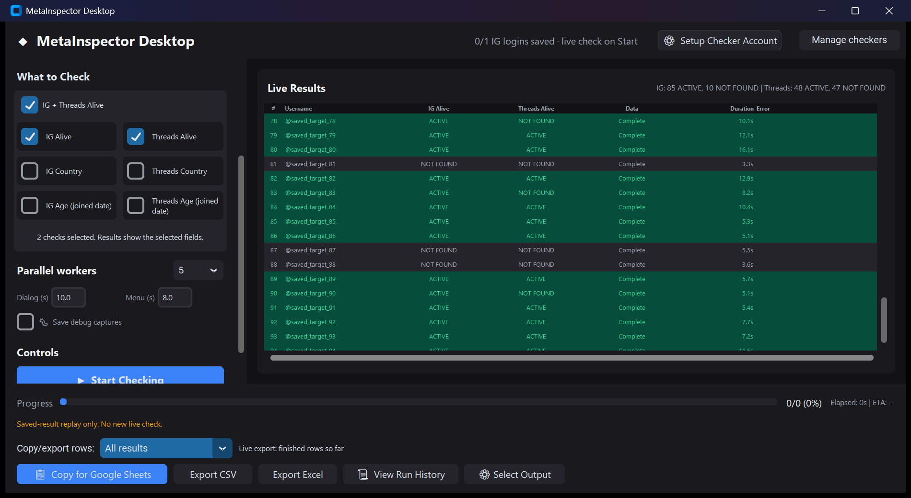
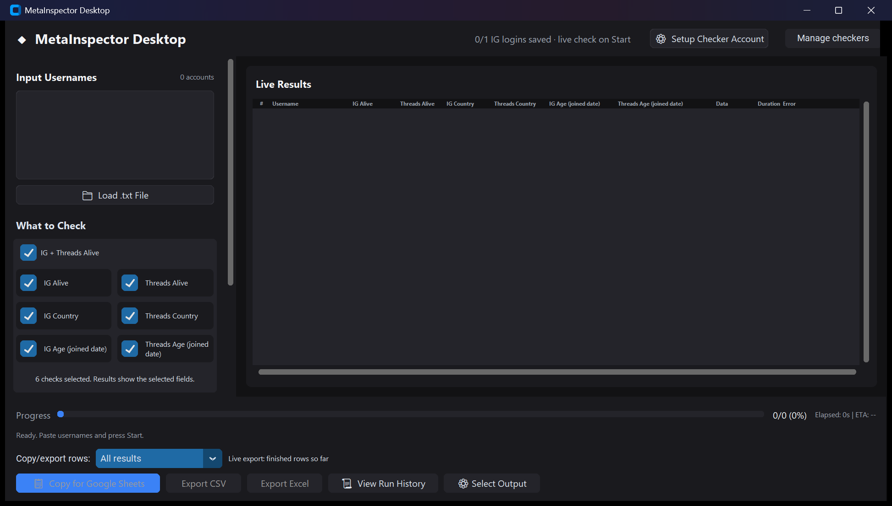

# What to Check and matching Live Results

Date: **17 October 2026**. Branch: `feature/selectable-checks-and-exports`.
Follow-up to `10f7de1`. Shared implementation report for Codex and Claude.

## Changes

- Removed desktop Checking Mode presets. What to Check is the only selector.
  All six fields start selected. Every GUI run passes the actual selected
  fields to the engine, including an untouched initial selection. CLI modes,
  including Combined and Smart Combined, remain available and unchanged.
- Each checkbox has a matching Live Results column: IG Alive, Threads Alive,
  IG Country, Threads Country, IG Age (joined date), Threads Age (joined date).
  The both-Alive shortcut selects the two independent status columns.
  Unselected fields are hidden; selected fields precede Data, Duration, Error.
- Alive cells use each platform's status. IG Active does not imply Threads
  Active. Unknown, read failure, missing profile and checker challenge remain
  distinct. The header counts each selected Alive platform separately.
- Explicit selected-check records retain the extractor's own per-platform
  status before legacy cross-platform ban linking can overwrite it. The
  legacy overall verdict is retained in details/exports. Legacy CLI Combined
  and its ban-linking behavior are unchanged.
- Country/date extraction and identity verification remain in place. No
  guessed values are added. Complete grades requested data, not whether an
  account exists: a confirmed Not found is a completed Alive check.
- New-run columns follow the checkboxes. Changing selection after a finished
  run prepares the next run while existing results retain their recorded
  columns. History reconstructs stored scope; old records without scope show
  all columns. Double-click retains complete record details and checker ID.
- Copy, CSV, Excel, selected export fields, Alive row filters and live snapshot
  export are retained. Export headers remain compatible: IG Status / Threads
  Status and IG Joined / Threads Joined.
- Status-only extractor calls no longer send two Escape key presses to close
  an About panel they never opened. Metadata calls still dismiss their panels.
  No worker, pacing, timeout, cache or retry defaults were changed.

## Why the supplied run took five minutes

Read-only inspection of the user's existing packaged-app journal
`run_20261017_145021_527066.jsonl` and history run `RUN_20261017_195521` found:

| Saved user-run measurement | Value |
| --- | ---: |
| Wall time stored in history | 300.06 seconds |
| Returned targets | 95 |
| IG Active / Not found | 85 / 10 |
| Threads Active / Not found | 48 / 47 |
| Rows with errors | 0 |
| Sum of per-target work times, concurrent | 757.64 seconds |
| Mean per-target work time | 7.98 seconds |

Every row requested only IG Alive and Threads Alive. The old table displayed
the overall 85 Active count while hiding the different Threads result.
Country/date reads were already skipped in this run.

Both platforms navigate sequentially within each worker. Logged-in workers
also retain their 4-8 second pause between targets, plus session preflight.
These operations contribute to elapsed time. Concurrent per-row work totals
are not wall time. This journal did not measure separate navigation, pacing
and preflight durations, so their exact shares cannot be stated. No network
or server root cause has been established from these records.

The removed Escape calls eliminate unnecessary browser actions but have no
measured wall-time saving here. A fresh speed result is not claimed.

## Verification

- Focused suite: **145 passed in 19.48s**.
- Full suite: **449 passed in 84.77s, zero skips**, including existing
  extraction, CLI, export, history and real Chromium/Tk tests.
- New tests cover all six column mappings, independent platform states,
  unknown/failure/skip handling, preservation of raw observed statuses, and
  real widget selection, summaries, history scope and removal of preset radios.
- Existing selected-extractor tests now assert no menu, panel or dismissal
  call for Alive-only extraction. Existing live snapshot exports still pass.
- Opened the source app with an isolated profile and replayed the saved 95
  rows without a browser. Compared **190 status cells with zero mismatches**.
  Preview usernames were replaced with anonymous row labels for the image;
  recorded statuses and timings were not changed.
- Initial sandbox test attempt: 119 passed, 26 setup errors caused by denied
  access to pytest's existing temporary directory. The authorized retry above
  ran with normal local test access. No assertions or tests were skipped. Final formatting/docstring-only edits
  had zero semantic AST differences from the tested source.
- A preview capture initially blocked its own Tk event loop while waiting
  for PrintWindow. The local helper was corrected to keep that loop running;
  the corrected source preview completed and was closed.
- Targeted audit: 48 production files, largest 460 lines; no prohibited dash
  characters in added text, no supplied password/2FA matches in candidate
  files. This is not a comprehensive security audit.

[Full suite](evidence/result-scope-full.txt),
[focused suite](evidence/result-scope-targeted.txt),
[saved-run replay counts](evidence/result-scope-replay.json).



## Delivery and limits

The old `dist/MetaInspectorDesktop.exe` was running during this update, so the
new executable was successfully built separately at
`dist/updated/MetaInspectorDesktop.exe` (325,066,271 bytes). Build command:

```text
python -m PyInstaller config/metainspector.spec --distpath dist/updated --workpath build --noconfirm
```

SHA256 and test/audit counts: [artifact evidence](evidence/result-scope-build.json).
The actual updated EXE launched with isolated app data, reported responsive,
and visually rendered all six matching field columns and checkbox controls.
Its own preview was closed after capture. No packaged scraping or new login
was initiated. Functional selection/export checks came from real Tk tests.



The user's open app and its saved login/history files are not terminated or
rewritten. Close the old app before starting checks in the updated app.

No fresh live Meta run, country/date accuracy audit, guaranteed fastest
runtime, sub-five-minute acceptance or clean-machine acceptance is claimed.
The 300.06-second number above comes from the user's saved run, not a new
benchmark. Replay verifies faithful table presentation of recorded data,
not whether those accounts' current online state has changed.

No merge into dev, branch deletion or remote push is part of this update.
