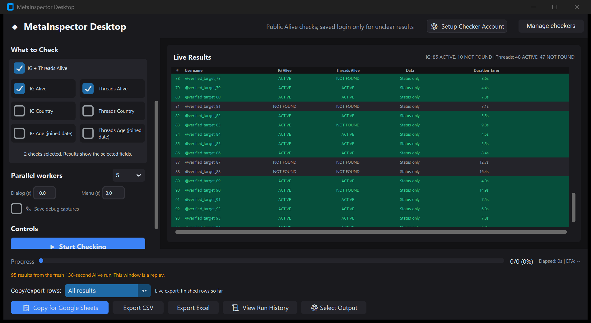

# Public-first IG and Threads Alive checks

> Follow-up, 18 October: retained Alive readiness changes measured 130.968s;
> 479 tests pass and the rebuilt EXE starts. The 120-second goal remains open.
> See [current evidence and rejected experiments](2026-10-18-alive-readiness.md).

Date: **17 October 2026**. Branch: `feature/selectable-checks-and-exports`.
Shared implementation and evidence report for Codex and Claude.

**Implemented and measured: 95 both-Alive targets in 137.969 seconds, zero
error rows. The requested 120-second ceiling is still not met.**

## What changed

- Selecting only Threads Alive, or IG Alive plus Threads Alive, now starts
  with a fresh anonymous browser context. GUI and CLI use the same engine.
  CLI modes are `threads_status_only` and `combined_status_only`; existing
  `--checks threads_alive` and `--checks ig_alive,threads_alive` select them.
- Public IG and Threads reads run concurrently on separate pages. Up to five
  public targets can run at once. No logged-in 4-8 second pacing is applied
  to public requests. Country/date/About extraction is not attempted.
- Threads Alive requires the requested URL and visible matching identity.
  Explicit missing-page text can establish Not found. A redirect to the
  Threads login page stays Unknown and triggers verification, never a guess.
- As explicitly chosen by the user, only unclear public results can use an
  enabled, existing saved checker session. Session health and expected
  identity are verified before use. There is no automatic credential login
  or onboarding in this flow. Failed session checks are cached for the run.
- Saved-login verification has its own queue, with at most five worker
  pages alongside the public pool. It retains the normal 4-8 second cooldown
  per worker. Public requests continue during those waits. Both-Alive with
  five workers can therefore have ten public pages plus five verification
  pages and a session-preflight page; these are not fifteen checker accounts.
- No usable saved session means Unknown with a reason. A checker challenge
  stops new work. Known platform results are preserved independently.
- Unresolved anonymous rendering gets one warm retry after the main pass.
  Known results, explicit login redirects and completed saved-login attempts
  are not blindly retried. Each attempted target is published once.
- Records retain `ig_status_source` / `threads_status_source` as `anonymous`
  or `saved_login`, visible in double-click details and local raw journals.
  A clear result has no error text. All requested clear Alive results grade
  Status only; missing country/date values are intentional scope exclusions.
- IG Alive alone retains the existing completely anonymous checker and warm
  retry. Country or Age selections retain the existing logged-in extraction
  flow. All six boxes remain the default selection; legacy Combined behavior
  and the matching Live Results columns are unchanged.

## Actual measurements

Same set of 95 distinct targets from the user's existing journal. New runs
used its recorded row order, five workers, headless Chromium, selective
resource blocker enabled, and default timeouts/pacing. Browser tests and
packaging did not run alongside these benchmarks. Wall time includes engine
startup, session verification and shutdown, but not EXE unpacking/GUI startup.

| Run | Wall seconds | Returned | Error rows | Source |
| --- | ---: | ---: | ---: | --- |
| Prior logged-in both-Alive | 300.060 | 95 | 0 | User's saved history, not rerun here |
| Public-only prototype, no fallback | 142.406 | 95 | 47 | Measured in this task; incomplete statuses |
| First production public-first version | 191.015 | 95 | 0 | Measured in this task; verification occupied public workers |
| Final independent queues | **137.969** | **95** | **0** | Measured in this task |

The final run is 162.091 seconds shorter than the saved user run, or 54.0%.
These are individual runs, not a controlled average or a guaranteed speedup.
It exceeds 120 seconds by **17.969 seconds**. No under-two-minute claim is made.

The prototype's 47 Unknown Threads results were login redirects, not 404
evidence. They are retained in the report rather than counted as successful
checks. An earlier four-target public probe independently showed matching
active profile identities and login redirects for missing-profile candidates.

Final observed results:

| Platform | Active | Not found | Unknown | Public reads that resolved status | Saved-login confirmations |
| --- | ---: | ---: | ---: | ---: | ---: |
| Instagram | 85 | 10 | 0 | 95 | 0 |
| Threads | 48 | 47 | 0 | 48 | 47 |

- Exact target-set equality, 95 unique rows, no duplicates or unstarted
  targets, no stop reason. Both platform statuses match the saved user run
  on every target, with zero differences across 190 status comparisons.
- Only the enabled saved `checker_1` was used in these fresh runs. No other
  checker was opened, and no password/2FA import or interactive login ran.
- Final run: 47 saved-login attempts, zero unresolved platforms and zero warm
  retries. All 95 rows report Status only. Blank metadata is not fabricated.
- Ordered target-list SHA256, lowercase usernames separated by newline with
  a final newline:
  `e71a7e70a3ed080d7627c5534c930477d86cc3cd35a060dfe128945e1249a950`.

Aggregate evidence: [prototype](evidence/anonymous-both95-probe-summary.json),
[first production run](evidence/alive-public95-production-summary.json),
[final production run](evidence/alive-public95-pipeline-summary.json).
Raw usernames, records and sessions remain local and ignored by Git.

### Additional performance comparison

Disabling the resource blocker on the same independent-queue implementation
was measured separately: **242.531 seconds**, 95 rows, seven Threads Unknown
results and seven error rows. IG remained 85 Active / 10 Not found; Threads
was 48 Active / 40 Not found / 7 Unknown. This diagnostic is rejected as a
default change. The selective blocker remains enabled.
[Diagnostic aggregate](evidence/alive-public95-unfiltered-summary.json).

The cache hypothesis was not established: this repository already uses
selective CDP Fetch patterns rather than wildcard Playwright routes. The
[Playwright routing documentation](https://playwright.dev/python/docs/api/class-browsercontext#browser-context-route)
warns that routing disables the HTTP cache; that warning alone does not prove
the existing selective blocker disables caching. No cache fix is claimed.

## Tests and GUI verification

- First focused suite: **173 passed in 21.34s**.
- Queue separation and further focused regressions: **178 passed in 18.94s**.
- Final full suite: **471 passed in 62.94s, zero skips**. Tests include real
  Chromium and Tk, selected checks, exports, history, previous extraction
  modes, session failure caching, disabled-slot exclusion, challenge stop,
  independent public progress during fallback waits and retained pacing.
- Real Chromium fixtures verify delayed Threads identity, ambiguous pages,
  bounded Unknown, singular/plural IG behavior through existing tests, and
  rejection of login redirects as account-status evidence.
- Opened the actual source GUI with an isolated profile and replayed this
  fresh run's 95 rows. All **190 status cells matched**, with the correct
  IG and Threads totals and only requested columns visible. The screenshot
  uses anonymized row labels. This replay did not initiate another network run.
- Targeted source audit: 52 production files, largest 472 lines. New modules
  have function annotations/docstrings; supplied credential scan found no
  password/2FA matches in candidate files. This is not a full security audit.

[Full test output](evidence/alive-public-full.txt),
[focused output](evidence/alive-public-targeted2.txt),
[GUI replay counts](evidence/alive-public-replay.json).

## Use and remaining limits

Close the older app before starting checks with the new build. Select only
**IG Alive** and **Threads Alive** for this fast path. Untick Country and Age;
those fields request the logged-in metadata flow. Keep the intended saved
checker enabled for unclear Threads verification. Copy, CSV, Excel, Alive row
filters and live snapshot export continue to work with the selected columns.

The executable is built separately at `dist/alive-fast/MetaInspectorDesktop.exe`
to preserve the user's running `dist/updated/MetaInspectorDesktop.exe`.
PyInstaller completed successfully in 132.695 seconds; size 325,084,187 bytes.
SHA256: `108ce4df560070ed9d2a1e37619cb78e588975fc487235c6383e1a823bec14a9`.

**Packaged launch is blocked, not verified.** A normal launch with isolated
app data was rejected by Windows with "An Application Control policy has
blocked this file." This was an operating-system refusal, not an automatic
tool-approval rejection. No security policy was disabled or bypassed. The
existing user app remains untouched. Source execution and the real source
GUI succeeded; the new executable's runtime still needs an allowed launch.
[Build and launch evidence](evidence/alive-public-build.json).

The tested source remains available through the existing development entry
point, `python main.py`. Source and packaged builds store their saved sessions
in different locations; a source launch does not automatically reuse the
packaged app's login. The live benchmark explicitly selected the existing
packaged profile directory and did not copy credentials or profiles.

No fresh country/date extraction audit, packaged 95-target benchmark, new
login/onboarding, clean-machine acceptance or all-future-run accuracy guarantee
is claimed. Agreement with the prior run is cross-run evidence, not a manual
inspection of every current profile. Rendering/network variability and saved
verification can still affect latency. The 1-2 minute goal remains open.

No merge into dev, branch deletion or remote push is part of this update.
